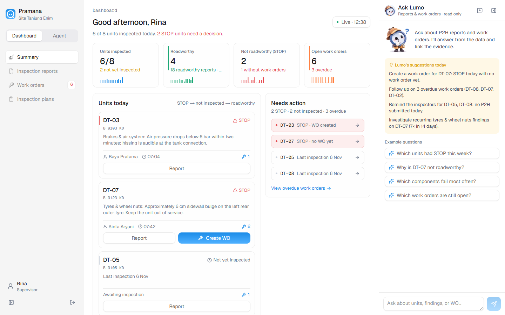

# Pramana

Pramana helps mining teams complete daily vehicle inspections, capture evidence,
and follow up on repairs. Lumo, its AI assistant, guides supervisors and
inspectors from an inspection plan to a report backed by photos and work orders.

The app supports P2H (*Pemeriksaan dan Perawatan Harian*, daily inspection and
maintenance). Its interface and assistant replies are in English, with dates
and operational reporting in Asia/Jakarta (WIB).



## What you can do

- **Build inspection plans:** describe a vehicle or upload a specification sheet,
  then refine the checks with Lumo and an interactive isometric vehicle model.
- **Inspect on a phone:** follow the inspection conversation, take photos or
  attach images from the gallery, and submit findings with supporting evidence.
- **Review the fleet:** see inspected, roadworthy and STOP units, inspection
  trends, recurring component findings, and searchable reports with PDF export.
- **Manage repairs:** create work orders from findings, assign mechanics, set
  deadlines, and record completion. Repair follow-up preserves the original
  inspection verdict.
- **Ask Lumo:** ask questions across reports and work orders, open the cited
  sources, and receive recommendations. This analyst is read-only and provides
  a clearly labeled data-based fallback when the model is unavailable.

## Technology

Pramana uses Next.js App Router, React, TypeScript, Tailwind CSS and TanStack Query.
Agents run through the OpenAI Agents SDK for JavaScript/TypeScript, with Zod
validation and server-enforced inspection rules. SQLite stores application data;
uploads, generated models and local agent traces are stored alongside it.
The Anatomy skill supplies the geometry workflow for interactive SVG vehicle models.

## Installation

### 1. Get the source

Install Git and either Docker with Compose 2.24 or newer, or Node.js 22.19 or
newer with npm. Docker is recommended for the complete app, including vehicle
model generation, which requires the Linux sandbox and its bundled tools.

```sh
git clone https://github.com/bangtoy/pramana-lumo.git
cd pramana-lumo/pramana
```

Run the following commands from this application directory.

### 2. Configure the agents

Create `.env.local` from the example on a fresh checkout:

```sh
# macOS / Linux
cp .env.example .env.local
```

```powershell
# Windows PowerShell
Copy-Item .env.example .env.local
```

If `.env.local` already exists, edit it instead of replacing it. Set these values
for your model provider:

| Variable | Purpose |
| --- | --- |
| `OPENAI_BASE_URL` | API endpoint, including `/v1`; use `https://api.openai.com/v1` for OpenAI or your configured gateway URL. |
| `OPENAI_API_KEY` | Your provider's API key. Keep it in `.env.local`, which is excluded from Git. |
| `OPENAI_MODEL` | A model available through your endpoint for planning, inspection and analysis. Replace the example value if needed. |
| `OPENAI_MODEL_HEAVY` | A model for vehicle-model generation; defaults to `OPENAI_MODEL` when omitted. |
| `DATA_DIR` | Local data directory; defaults to `./data`. Docker sets this to `/data` in its persistent volume. |

The agent client uses the Responses API by default. For a compatible gateway
that uses Chat Completions, set `OPENAI_API_MODE=chat_completions`. The selected
models must support the tools and image inputs used by the agents. When an API
runs on your host computer, use `host.docker.internal` instead of `localhost`
in its URL when running Pramana in Docker.

You can browse the seeded dashboard without a model configuration. Planning,
inspection conversations and model generation need a working provider;
Ask Lumo can still answer through its labeled data-based fallback.

### 3. Start the app

**With Docker (recommended):**

```sh
docker compose up -d --build app
docker compose ps
```

Open [http://localhost:3000](http://localhost:3000). Demo records are seeded
automatically on first startup; subsequent starts preserve existing data.

If port 3000 is already in use, choose a different host port:

```sh
# macOS / Linux
export PRAMANA_PORT=3002
docker compose up -d --build app
```

```powershell
# Windows PowerShell
$env:PRAMANA_PORT = '3002'
docker compose up -d --build app
```

Then open `http://localhost:3002`.

**With Node.js for local development:**

```sh
npm ci
npm run dev
```

Open the address printed by Next.js. The database initializes automatically on
the first data request. Use the Docker app to generate vehicle models; local
development can display existing models.

For a production Node.js build:

```sh
npm run build
npm start
```

## Try the workflow

1. Choose **Continue as supervisor** on the home page. Open **Agent** to create
   an inspection plan, or explore an existing plan.
2. Choose **Continue as inspector** to inspect a vehicle and submit photo evidence.
3. Return to **Summary** and **Inspection reports** to review findings.
4. Create work orders, assign repair follow-up, and ask **Lumo** about the evidence.

For phone camera access, start the included HTTPS tunnel after the Docker app:

```sh
docker compose up -d tunnel
docker compose logs tunnel
```

Open the `https://...trycloudflare.com` address shown in the logs on your phone.
The tunnel makes this demo publicly accessible. The app currently has no login,
so use demo data. The temporary URL may change when the tunnel is recreated.
Stop public access with `docker compose stop tunnel`.

## Data and maintenance

Docker stores the database, uploads, models and traces in the `pramana-data`
volume. `docker compose down` stops the services and preserves that volume.
`PRAMANA_VOLUME` can select an existing volume; keep it consistent across Compose
commands. Local development stores data under `pramana/data/` by default.

Demo history is seeded once with dates relative to its initial setup. It does
not roll forward each day. See the [application guide](pramana/README.md) for
seed/reset behavior and additional operational details.

Useful commands from `pramana/`:

```sh
npm run typecheck
npm test
npm run build
docker compose logs app
```

## Repository guide

| Location | Contents |
| --- | --- |
| [`pramana/`](pramana/) | Next.js app, agents, database, tests and Docker configuration. |
| [`design/`](design/) | Design system, reference screens, Lumo artwork and vehicle assets. |
| [`docs/PRD.md`](docs/PRD.md) | Product requirements. |
| [`docs/adr/`](docs/adr/) | Architecture decisions. |
| [`docs/tickets/`](docs/tickets/) | Implementation tickets and Definition of Done. |
| [`docs/verification/`](docs/verification/) | Verification results, screenshots and demo instructions. |
| [`docs/README.md`](docs/README.md) | Original project README and design-kit instructions. |
