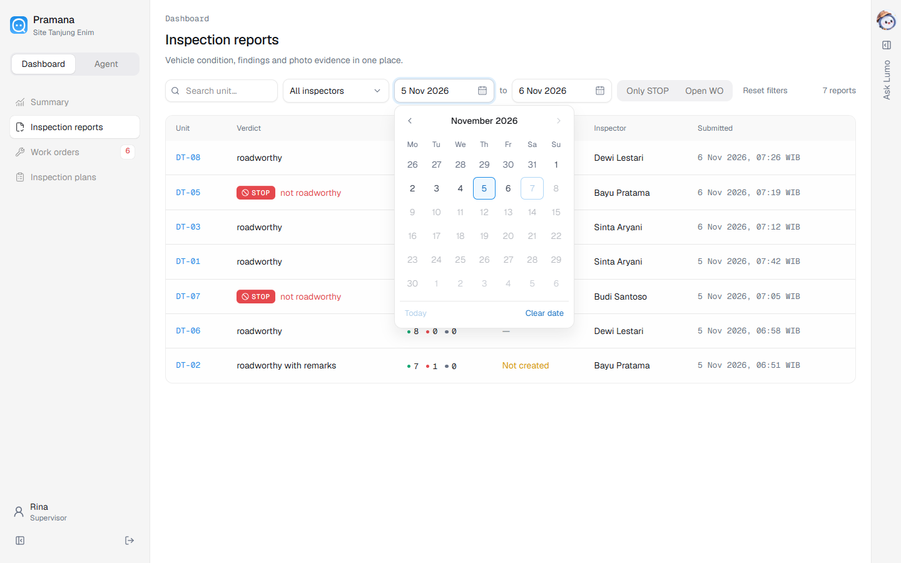
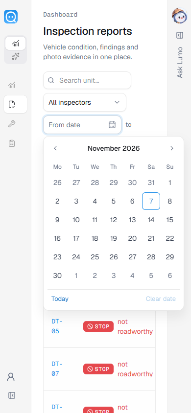
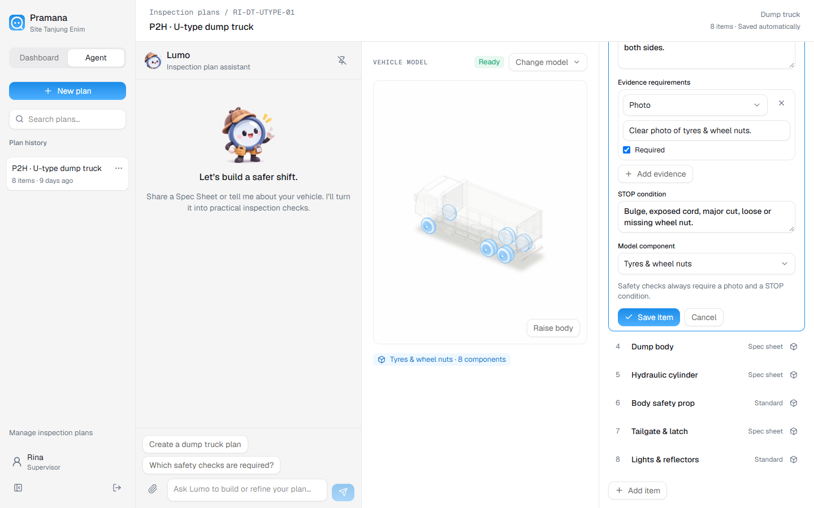

# Andra filter picker merge

Verified on 7 November 2026. Merged `origin/andra` at `96fb2f7` into `main`
at `8513bdc` in a separate checkout. Git reported no conflicts. No additional
implementation changes were needed after validation.

The update unifies inspector, priority and chart dropdowns, adds calendar
pickers for report date filters and work-order targets, improves popover focus
handling, and keeps the Agent model visible while editing in pinned and docked
layouts. Existing filter URLs and server mutation paths are retained.

Validation used a separate Docker container on port 3005 with fresh demo data:

- TypeScript, 34 tests, production build, typography/color scans and staged
  whitespace checks passed.
- `pickers-ui-check.mjs` passed inspector selection with an unsaved unit filter,
  date URL persistence, keyboard navigation, minimum/maximum dates, clearing,
  mobile calendar bounds, priority selection, target changes, completed-order
  disabling, chart views and model visibility in short/mobile viewports.
- `planner-polish-check.mjs` passed history scrolling, unclipped menus,
  select keyboard interaction, attachment previews, retry drafts and dock/pin
  regressions. Browser mutation/agent requests in these checks used fixtures.
- No browser console errors. The user's uncommitted icon/branding files were
  excluded from the validation checkout and preserved in the main workspace.

Results: [andra-picker-merge-results.json](andra-picker-merge-results.json).

