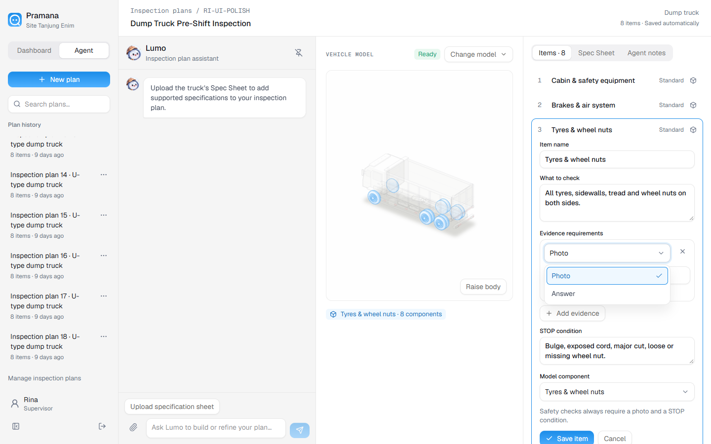
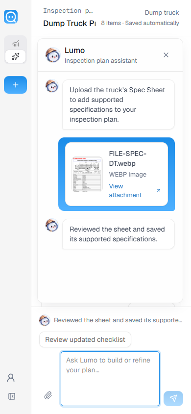
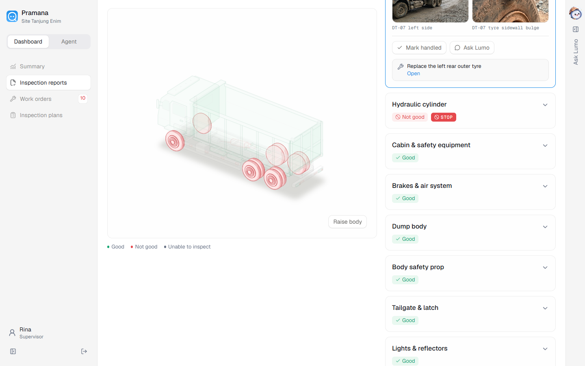

# Andra UI polish merged into main

Verified on 7 November 2026. Merged `origin/andra` at `d035878` into local
`main` at `b77cc9e`. Git merged all 13 changed files without conflicts. No
additional implementation changes were needed after integration checks.

The incoming changes improve the planner history sidebar, keyboard-accessible
select menus, attachment previews and processing states, and keep the vehicle
model visible when scrolling a wide inspection report. The current Ask Lumo
recommendations, charts, panel resizing and multiline composer are retained.

Validation:

- TypeScript: passed. Unit/integration tests: 34 passed.
- Docker production build: passed. Existing data volume preserved; container
  on port 3002 is healthy.
- `planner-polish-check.mjs`: passed sidebar scrolling, unclipped menus,
  dropdown mouse/keyboard interaction and saving, image/PDF attachments,
  processing states, dock/pin layouts, preview reload, object URL cleanup,
  retry draft preservation, and mobile overflow checks.
- Report model remains at 20 px from the top while the report scrolls on
  desktop; mobile uses the normal stacked layout.
- Recommendation navigation and multiline composer regression checks passed
  at 1440×900 and 390×844. Report/work-order records were unchanged.
- No browser console errors; typography/color scans and staged whitespace
  checks passed. Agent interactions and plan mutations in browser checks used
  route fixtures; no real agent invocation or saved test plan was created.

Detailed results: [andra-ui-merge-results.json](andra-ui-merge-results.json).

