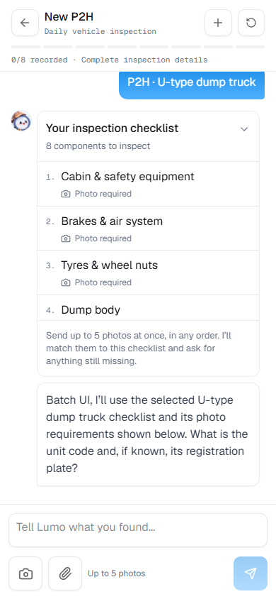
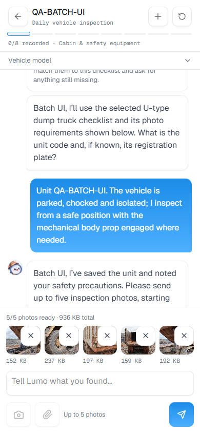
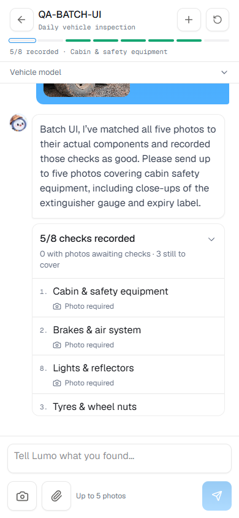
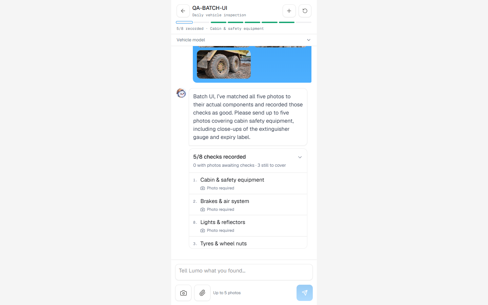

# Batch inspection photos and checklist introduction

Branch: `feat/batch-inspection-photos`. Verified on 7 November 2026.
Preview: <http://localhost:3008/petugas>. Production remains on port 3002.

## Behavior

1. Choosing a plan displays its full component checklist and photo requirements
   in the conversation before collecting the remaining unit details.
2. The gallery accepts up to five photos per message. Camera captures can also
   accumulate in the preview. Inspectors can add or remove images before sending.
   Each image is compressed below 300 KB; the server enforces count and size.
3. Lumo reviews each photo against the actual checklist, in any upload order.
   Captions and exact photo-to-item links remain saved in the draft.
4. Supported findings are recorded together. The conversation shows recorded
   checks, saved photos awaiting confirmation and items still needing evidence.
   One uncertain photo does not hold up other supported items.
5. Later confirmation can use already uploaded evidence. The next question asks
   for missing evidence or a direct check, and explicit submission is still required.

The client sends repeated multipart `file` fields. The shared turn reader labels
each image with its own file ID; planner requests retain the single-file limit.
`review_photos` validates ownership and checklist IDs. `record_items` validates
all findings through existing server rules inside a transaction, including photo
mapping, mandatory evidence and header completeness. A rejected finding rolls back
the group. Batch recording cannot overwrite completed items. Switching an unstarted
plan clears old photo mappings. Ordinary single-photo turns keep their compact UI.

## Actual agent checks

Original Normal/Issue files came from
`D:\Orca\example file\Foto-P2H\02-Dump-Truck-Tronton-U-Type`.
Image bytes were unchanged in the API scenarios and filenames were neutralized.
Operator accounts are simulated test inputs, not physical checks by the runner.

| Scenario | Observed result |
|---|---|
| Five shuffled photos with direct checks | All five matched to the correct item and recorded as good |
| Remaining three photos with functional observations | All eight items complete; still a draft until explicit submit |
| Five photos including an unconfirmed cabin check | Four recorded immediately; cabin photo retained and accepted after a text-only confirmation |
| Duplicate tyre photo, unrelated mascot, damaged dump floor and normal hydraulics | Three distinct checks recorded; duplicate not double-counted, mascot unused, damaged floor STOP |
| Five photos with no message text | All five matched; three visual checks recorded, two retained pending further checks; unpictured items stayed incomplete |

These are scenario checks, not a general vision-accuracy benchmark. Photo count
does not guarantee the same count of completed items: some photos cover the same
component, and a photo cannot establish every functional test. Existing STOP,
mandatory evidence and explicit-submit rules remain in force.

## Validation

- TypeScript, Docker production build and all 46 tests passed.
- Server regressions cover five distinct image references, captions after history
  compaction, upload count/size/type rejection before writes, ownership, mapping,
  transaction rollback, duplicate and completed-item rejection, incomplete submit,
  unusable evidence, and clearing mappings when the plan changes.
- Browser scenarios cover checklist display before the unit, gallery selection,
  camera availability, five previews, removal/addition, the limit, persisted image
  sizes, five findings plus three remaining items, and reload at 390×844 and 1440×900.
- The initial browser harness could not parse Chromium's multipart request-body
  representation. The actual upload had succeeded; the saved report and all five
  files were inspected. The harness now verifies persisted files directly.
- Physical phone gallery multi-selection and keyboard behavior require device QA.

## Reproduction and evidence

Use the isolated branch preview on port 3008 with its own data volume:

```powershell
docker build -t pramana-batch-photos .
docker run -d --name pramana-batch-photos --env-file .env.local -e DATA_DIR=/data --add-host host.docker.internal:host-gateway -p 127.0.0.1:3008:3000 -v pramana-batch-photos-data:/data pramana-batch-photos
node scripts/batch-inspection-agent-check.mjs
# Set PLAYWRIGHT_MODULE to the local Playwright module before the browser check.
node scripts/batch-inspection-ui-check.mjs
```

Run from `pramana/` after the preview's health endpoint responds. The API check
accepts `BATCH_CASE=normal|pending|mixed|photo_only` to run a single scenario.

- [Normal complete workflow](batch-inspection-normal.json)
- [Confirmation without re-upload](batch-inspection-pending.json)
- [Duplicates, unrelated photo and STOP](batch-inspection-mixed.json)
- [Photo-only batch](batch-inspection-photo_only.json)
- [Browser results](batch-inspection-ui.json)





