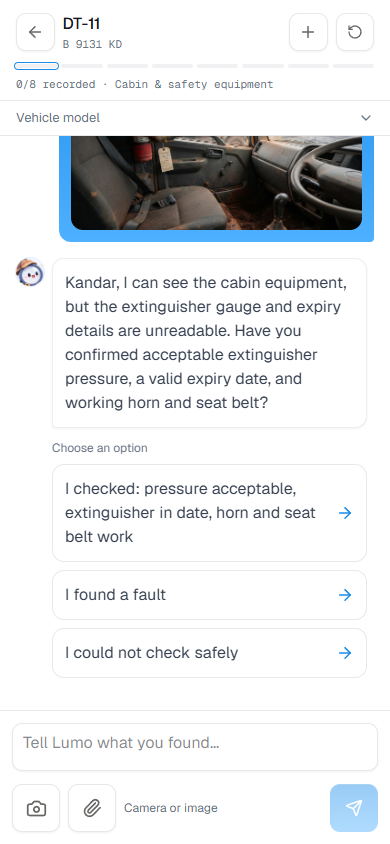
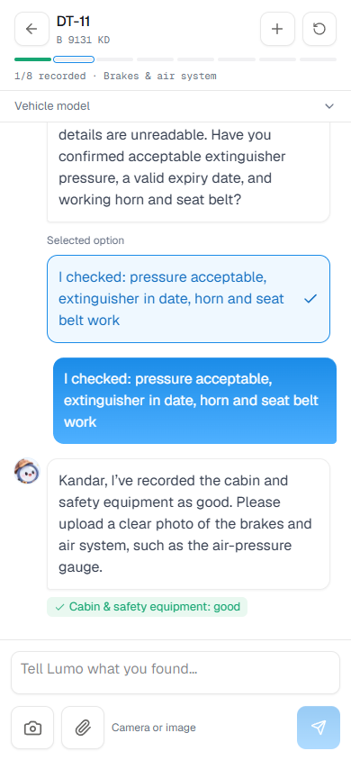
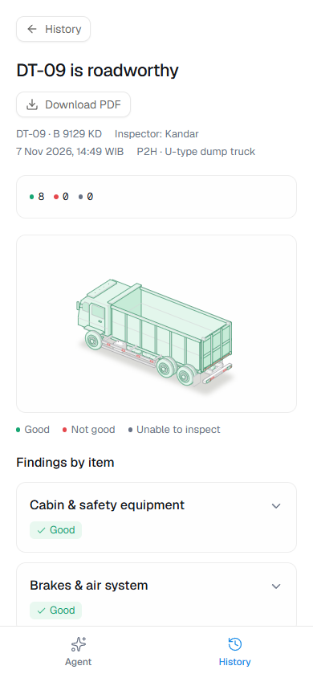
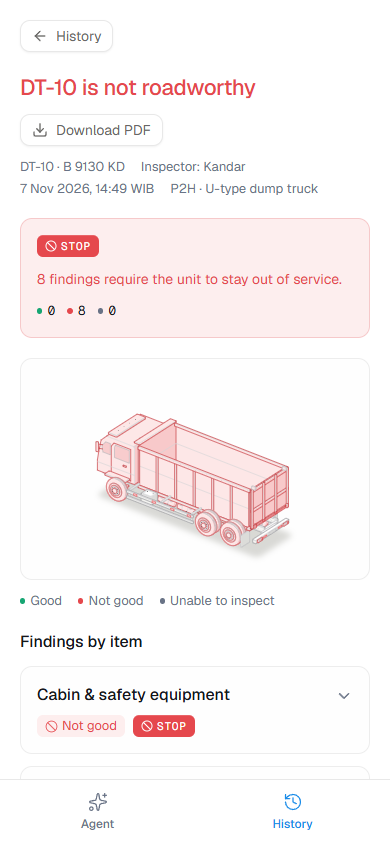

# Field inspection simulation: supplied Normal and Issue photos

Run date: 7 November 2026. Source assets:
`D:\Orca\example file\Foto-P2H\02-Dump-Truck-Tronton-U-Type`.

## What was tested

Production Docker was rebuilt and started before testing. Actual agent requests
then ran in separate databases/containers on ports 3005–3007; production
inspection records were not modified. The configured models were
`gpt-6.1-sol` and `gpt-6-astra`, using the same Agents SDK workflow and provider
configuration. The original 16 JPEGs are 1280×698 and below 300 KB each.

The focused comparison used controlled one-item snapshots of the real
`RI-DT-UTYPE-01` checklist, with inspection headers already completed. Each model
received the same original bytes, neutral upload names and the same short
Indonesian reports. Folder labels Normal/Issue were not provided to the agent.
SHA-256 hashes match across all three runs. These focused cases measure item
acceptance and clarification; the separate full flows test the complete plan.

| Configuration | Normal recorded on first photo turn | Normal recorded after confirmation | Extra normal turns | Issue STOP after observations |
|---|---:|---:|---:|---:|
| Original prompt, Sol | 3/8 | 8/8 | 5 | 8/8 |
| Original prompt, Astra | 2/8 | 8/8 | 6 | 8/8 |
| Revised prompt, Sol | 5/8 | 8/8 | 3 | 8/8 |

Each model/case was run once. This is a scenario comparison, not a general
accuracy or latency benchmark. Direct-check confirmations are scripted
simulation inputs, not measurements of the physical vehicle in the photos.

## Findings and change

Both original models requested new close-ups for unreadable extinguisher/gauge
details, yet accepted the same photo after a direct operator account. Sol was
therefore capable of processing this set; switching to Astra did not remove
the friction. The original instruction encouraged asking for a new image and
treated unverified safety equipment as STOP without distinguishing a missing
photo detail from an observed defect. Server rules enforce photo count,
attachment ownership, completeness and explicit submission; they do not judge
visual clarity or require every functional test to be visible in a photo.

The revised inspector instructions:

- Accept a relevant documentation photo plus direct inspector observations.
- Distinguish visible facts, operator reports and unknown checks in the finding.
- Ask one targeted confirmation for unseen function or unreadable label details,
  with a clear positive quick reply and an unable-to-check option.
- Accept the scoped confirmation without restarting the checklist or requiring
  a long explanation. Routine visual checks with a normal account do not need
  every angle photographed.
- Request another image for unusable/unrelated evidence or material unresolved
  contradictions; a limitation of the photo alone does not create a defect.
- Preserve critical visible/reported defects, mandatory photos and unsafe-check
  STOP behavior. Production stays on Sol; no model configuration was changed.

For the three remaining Normal confirmations (cabin, brakes and lights), the
revised run used generated quick replies successfully. Confirmation text
entered fell from 1,136 characters in the original Sol test's detailed operator
accounts to 175 characters represented by three button choices. This compares
the tested input methods, not an estimated field typing time.

## Complete workflows and controls

- Full Normal workflow: headers, eight original photos with concise direct
  observations, explicit submit: **10 turns, 8 good, 0 STOP, submitted**.
- Full Issue workflow: headers, eight original photos with actual scenario
  defect observations, explicit submit: **10 turns, 8 critical findings,
  8 STOP, submitted**. Unperformed functions remain noted as unknown.
- No item requested a replacement photo in either complete flow. Completion
  did not imply automatic submission: both remained drafts until instructed.
- Five live controls passed: missing mandatory photo, unrelated photo, tyre
  defect despite a normal claim, damaged prop despite a normal claim/unsafe
  request, and an explicitly unperformed critical brake check. Incomplete
  submission stayed blocked; an unsafe check was recorded with a reason and STOP.
- Actual mobile UI: gallery upload through `InspectorChat` and `compressImage`,
  127,648-byte original → 119,186-byte upload; one confirmation card advanced
  the full report to 1/8, good, without STOP. No browser errors or horizontal
  overflow. A test-harness streaming-body observation failed; persisted state
  was inspected and the same report resumed, without repeating the photo turn.
- TypeScript, production build and all 40 existing tests passed.

## Evidence and reproduction

- [Original Sol cases](field-inspection-baseline-sol.json)
- [Original Astra cases](field-inspection-baseline-astra.json)
- [Revised Sol cases](field-inspection-tuned-sol.json)
- [Full Normal transcript and findings](field-inspection-full-normal.json)
- [Full Issue transcript and findings](field-inspection-full-issue.json)
- [Live controls](field-inspection-controls.json)
- [Mobile browser evidence](field-inspection-browser.json)
- [Aggregate verification](field-inspection-summary.json)
- [Photo capture / reporting guide](field-inspection-photo-guide.md)

The isolated review app remains available locally on port 3007:
[Normal report](http://localhost:3007/petugas/riwayat/LI-163aa412-82bc-4dff-a161-aab65016ef75)
and [Issue report](http://localhost:3007/petugas/riwayat/LI-f0329dab-38f4-471e-b6e5-4f2c748d4ca0).
These are simulation records, separate from production on port 3002.

Use an isolated Docker container with `DATA_DIR` containing `field-simulation`.
`scripts/seed-field-simulation.mjs` produces case IDs and two empty full reports;
set `SIM_SET=controls` to produce the negative controls. Supply its output path
as `SIM_CASES`. `field-photo-simulation.mjs` accepts `SIM_BASE`, `SIM_LABEL`,
`SIM_OUT`, `SIM_ASSETS`, and `SIM_QUICK_CONFIRM=1`; full-flow and control scripts
use port 3007. All model/agent calls are real. Credentials remain in the local
environment file and are never written into results.

Official documentation confirms [Sol supports image inputs](https://developers.openai.com/api/docs/models/gpt-6.1-sol)
and describes [small-text and visual-accuracy limitations](https://developers.openai.com/api/docs/guides/images-vision).
The operational recommendations above come from the supplied-photo runs.

