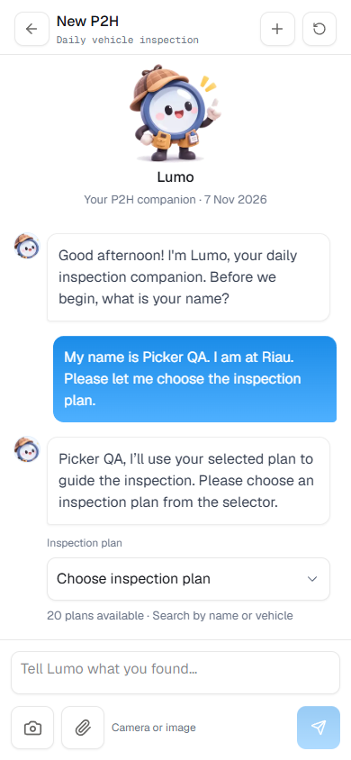
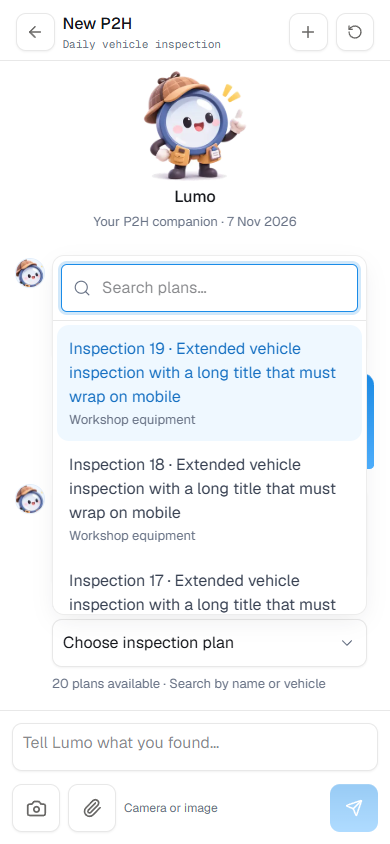
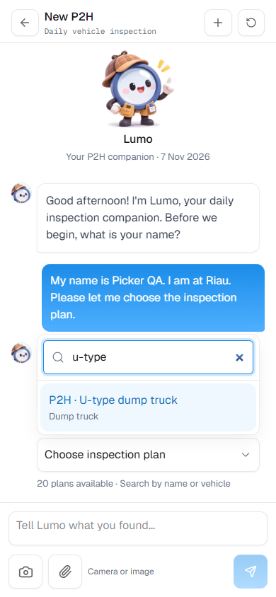
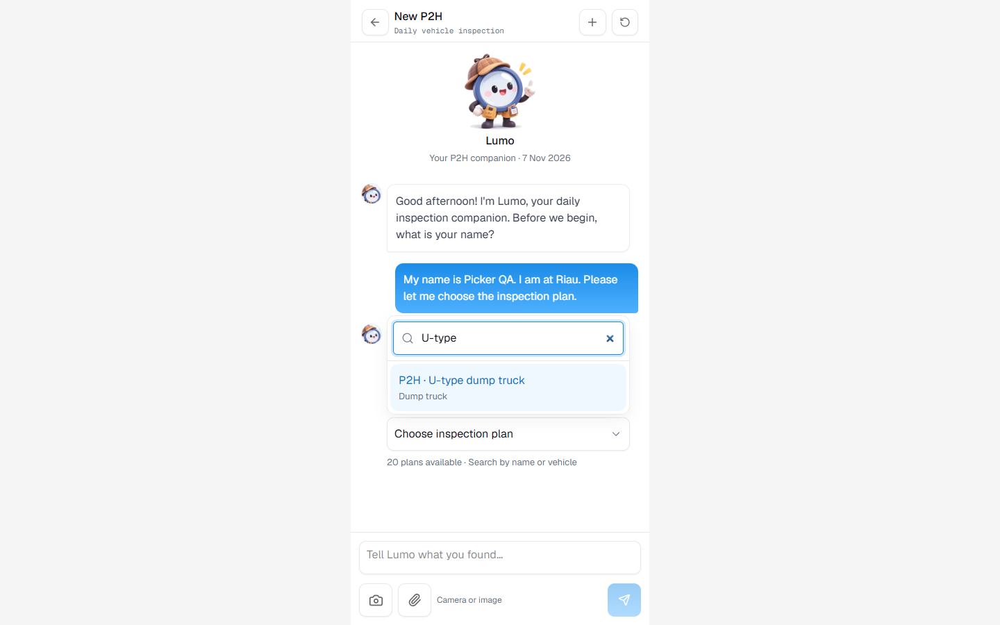

# Searchable inspection plan selection

Verified on 7 November 2026.

## Cause

The production database contained six active, non-empty inspection plans,
including `RI-DT-UTYPE-01` (P2H · U-type dump truck). The existing Andra draft
contained only four agent-generated quick replies. The inspector output schema
limits ordinary quick replies to four, so using them as the plan catalog omitted
valid plans. The plan was not missing from production or restricted to simulation.

## Change

- When plan selection is pending, the report response supplies every active,
  non-empty plan directly from the database, including for existing drafts.
- A compact selector appears inside the current chat message. Search matches
  plan title, vehicle type and ID. Its dropdown scrolls, wraps long titles and
  supports touch, arrow keys, Enter, Escape and outside dismissal.
- Choosing an option sends its exact ID. The server validates eligibility and
  saves the plan snapshot before Lumo continues with missing unit details.
  Duplicate titles cannot select a different plan by accident. Stale, archived,
  empty or unavailable selections are rejected.
- Ordinary inspection confirmation questions keep their reply cards. No
  production plans, photos, findings or draft header values were rewritten.
- The shared anchored popover observes content size so filtered results remain
  attached to the trigger when the list shrinks.

## Verification

- Regression reproduced before the fix: the report had four choices and omitted
  U-type although the plan API included it. New regression tests failed before
  implementation and passed afterward.
- TypeScript, all 42 tests, production Docker build and design token/type scans
  passed.
- Real agent flow in a disposable database on port 3008 with 20 active plans:
  search/select U-type, persist its exact ID and eight-item snapshot, then ask for
  unit details. Production inspection data was not used for test writes.
- Chromium mobile emulation at 390×844 and desktop at 1440×900: all 20 plans,
  title/vehicle searches, no-match state, wrapped titles, bounded scrolling,
  dropdown placement after filtering, keyboard choice, touch opening, dismissal,
  draft reload and persisted selection passed. No browser console errors or
  horizontal overflow. Physical phone keyboard behavior was not tested.
- Existing picker regression suite passed: report inspector/date filters,
  work-order priority/target picker, chart views and planner layouts. Its
  work-order writes were intercepted by the existing test harness.
- Production Docker is healthy. Read-only verification of the user's existing
  draft returned all six plans, including U-type; name and location remain saved.

Reproduce in a disposable app container on port 3008 with a separate `DATA_DIR`:
set `PLAYWRIGHT_MODULE` to the local Playwright module and run
`node scripts/inspection-plan-picker-check.mjs` from `pramana/`.
The script creates plans and a draft only on that fixed test port.

[Agent/browser results](inspection-plan-picker.json)

