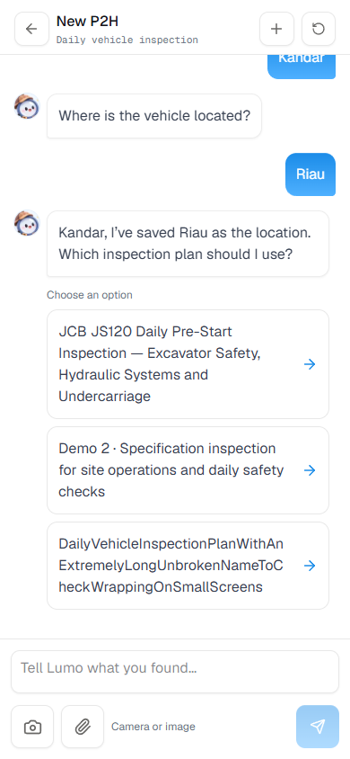
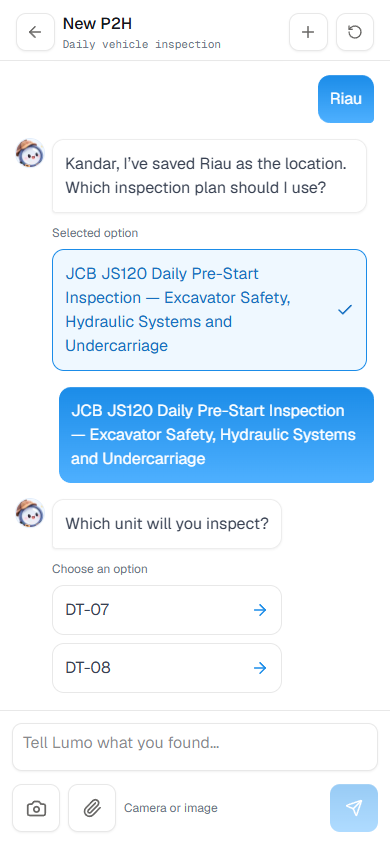
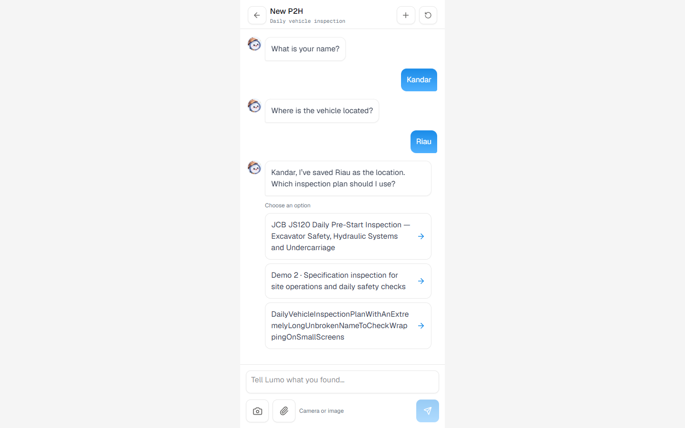
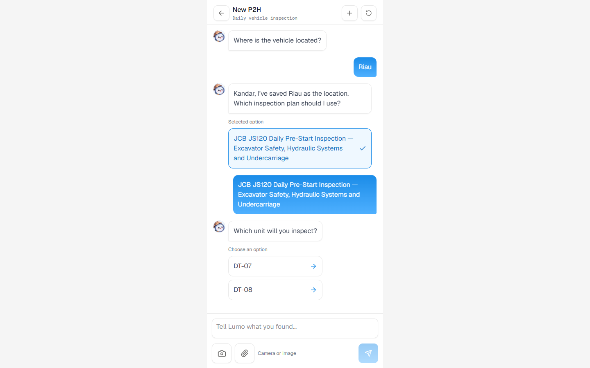

# Inspector reply choice cards

Verified on 7 November 2026 at `/petugas` in the Docker app on port 3002.

Inspection quick replies now appear as vertically stacked cards immediately
after the corresponding Lumo message in the conversation. Full labels wrap,
including long unbroken names, with no horizontal choice strip above the input.
All current inspector quick replies use this layout, including plan selection.
After the next reply, the chosen card remains marked in history and disabled;
unused historical options are hidden. Current choices are disabled while a
photo is prepared or Lumo is responding.

TypeScript and the production Docker build passed. Browser checks at 390×844
and 1440×900 verified 16 px text, full labels, minimum 48 px targets, keyboard
selection, a single turn request, disabled choices while pending, selected
history after reload, input visibility and no horizontal overflow. No browser
console errors. Report and agent responses were browser fixtures; no saved
inspection or real agent call was created. Design scans and whitespace checks
passed; the Docker container is healthy.

Results: [inspector-choice-cards-results.json](inspector-choice-cards-results.json).

