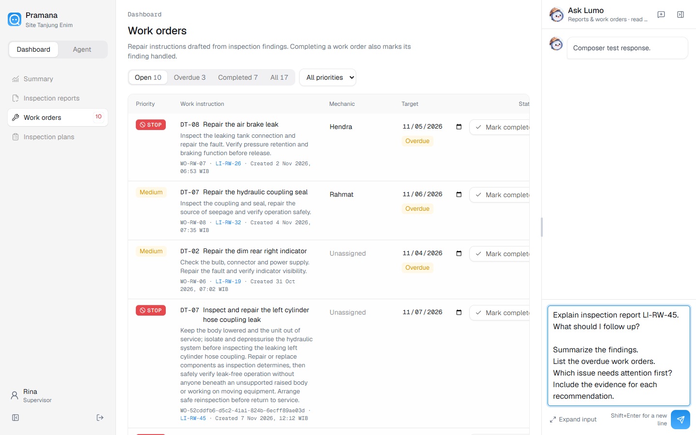
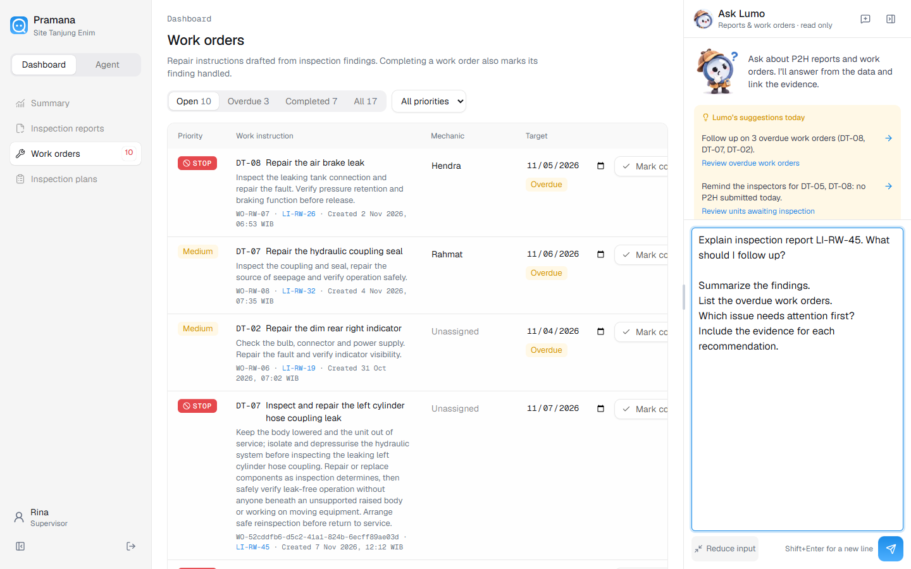
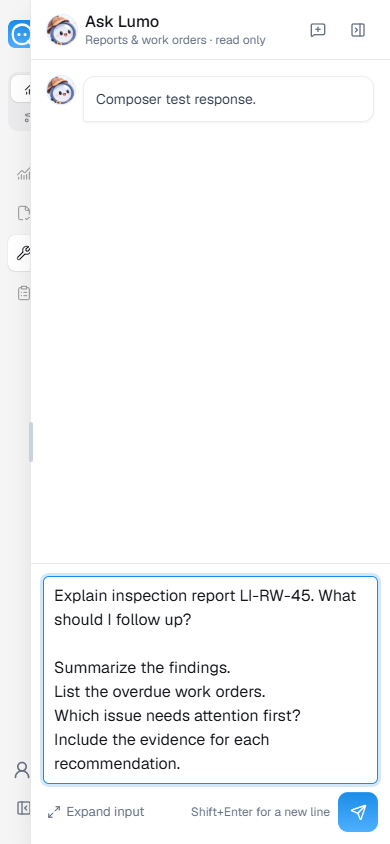
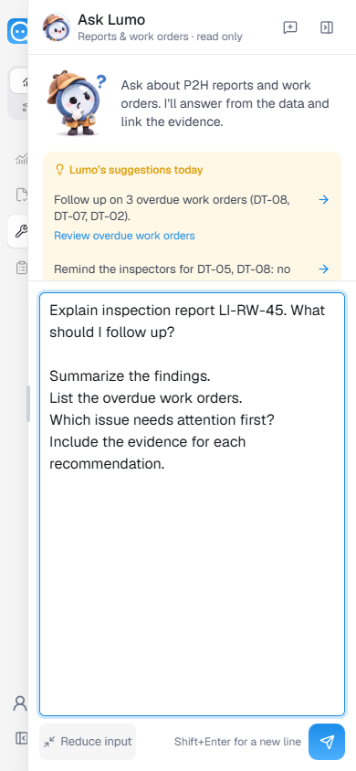

# Ask Lumo multiline input

Verified on 7 November 2026 at `/supervisor/work-order` in the Docker app on
port 3002.

The question input now spans the panel width, starts at 96 px with 16 px text,
and grows with typed or pasted text up to 320 px / 40% of viewport height.
“Expand input” provides up to 480 px / 55% of viewport height; “Reduce input”
returns to automatic sizing. Longer drafts scroll within the input. The send
button and keyboard hint sit below it. Sending or starting a new conversation
resets its height.

Validation: TypeScript and Docker production build passed; the deployed
container is healthy. Typography/color scans and `git diff --check` passed.
Chrome checks at 1440×900 and 390×844 verified automatic growth, expand/reduce,
preserved text across panel close/reopen, reflow when resizing panel width,
Shift+Enter inserting a newline, Enter sending the full question, and height
reset after send. No overflow or browser console errors. The send response was
a browser route fixture; no agent call or stored conversation was created.

Measured sizes and checks: [lumo-composer-results.json](lumo-composer-results.json).

