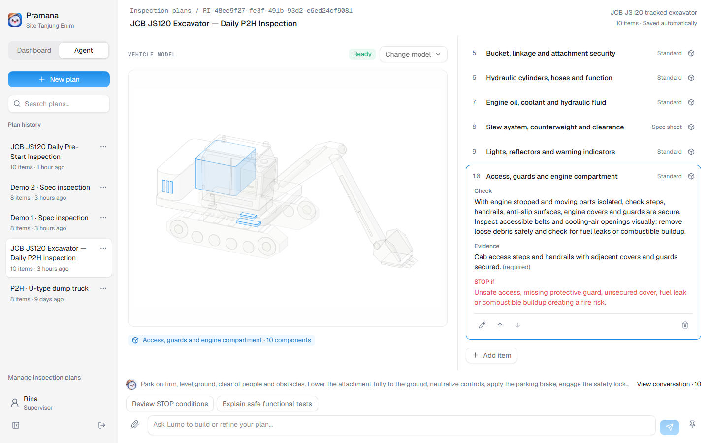
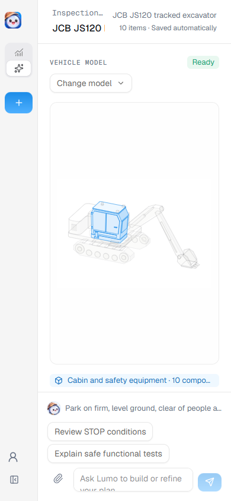

# Marcel model generation fix merge

Verified on 7 November 2026. Merged `origin/marcel` at `7c5b296` (including
model fix `53ceb7a`) into `main` at `ad945d3` without Git conflicts.
No additional implementation changes were needed after validation.

The model manifest now permits visual components with no associated checklist
items. Every current checklist item must still map to visible geometry, and
unknown item IDs remain rejected. SVG validation accepts exactly one literal
six-digit hex fill declaration; the renderer converts it to a presentation
attribute so Anatomy theme and focus styles can override the color. Other
unsupported styles remain rejected. The builder prompt explains unmapped
visual components and reusing drafts; independent geometry auditing is retained.

Validation:

- TypeScript, 36 tests and Docker production build passed. Tests cover empty
  visual mappings, required inspection coverage, unknown IDs, missing geometry,
  literal fills and rejected compound styles.
- Replayed the saved excavator SVG and manifest through the merged validator:
  10 components and all 10 inspection items accepted. No new agent generation
  run was started; this verifies the acceptance and rendering paths directly.
- Browser checks on the saved excavator verified all 10 component highlights.
  A browser route fixture added a literal fill to one top face and confirmed
  removal of inline style, preservation as a fill attribute, and focus coloring.
- Desktop 1440×900 and mobile 390×844 had no browser console errors or page
  overflow. Screenshots and [results](marcel-model-merge-results.json) are saved.
- Typography/color scans and staged whitespace checks passed. The branch's
  updated presentation problem slide also rendered without missing images or
  browser page errors.
- The production Docker container on port 3002 is healthy; the existing data
  volume is preserved. Latest icons, pickers and Ask Lumo features are retained.

