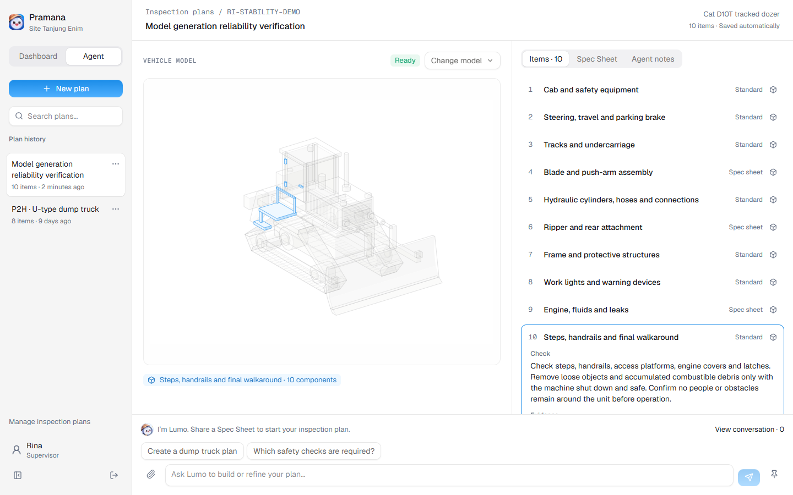
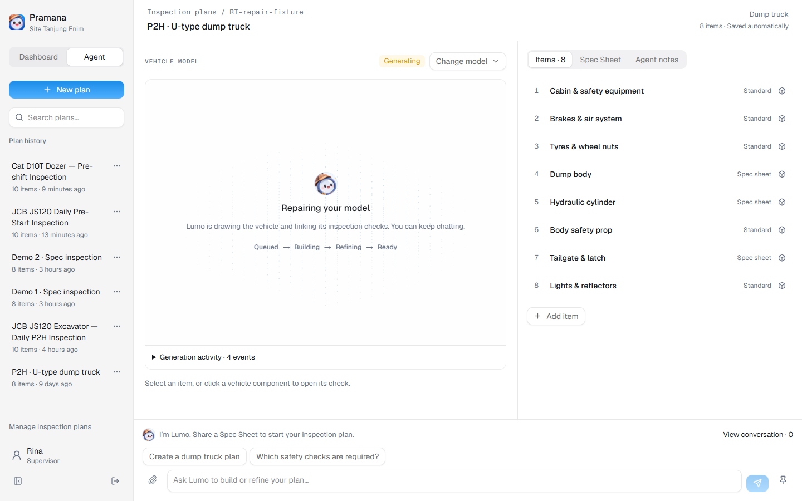
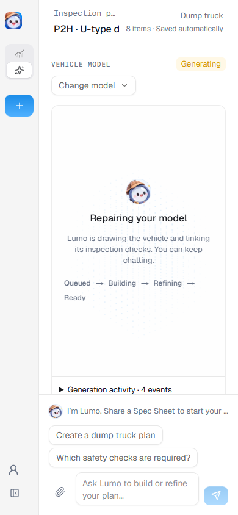

# Model generation reliability

Verified on 7 November 2026.

## Confirmed cause

Saved Dozer job `MDL-771293f8-7c1b-4262-aae8-903337956a8c` had a complete
independent report with zero problems and a passing quality report. Its builder
printed `{ problems: 0 }` to the console and wrote `audit passed` to `audit.log`.
The app required the exact phrase in console output, so it rejected valid
geometry. Replaying the old predicate against the captured console output
reproduced the user's exact error.

## Changes

- Acceptance requires exit code zero, every one of the kit's 13 check summaries
  with zero counts, and a passing quality report. The console success phrase is
  optional. Missing, duplicate, contradictory and nonzero summaries fail.
- Each independent build removes old SVG, manifest, quality and audit outputs
  before running. Retained successful files cannot approve a broken rebuild.
- A failed validation gets one automatic agent repair in the same sandbox and
  job, followed by the same independent validation. The shared generation
  deadline and abort signal bound the repair. Genuine failures remain failures.
- The activity view shows “Repairing your model” while repair is running.
- Docker's readiness probe explicitly exits after checking the HTTP status,
  with a four-second fetch deadline. Previously a successful HTTP response
  could leave the probe alive until Docker's five-second timeout.

## Evidence

- `npm run typecheck`, production build and all **40 tests passed**.
- Regression fixture: [original zero-problem console output](../../pramana/test/fixtures/anatomy-zero-audit.log).
- Tests exercise real audit report acceptance/rejection, failed/timeout exits,
  missing evidence, one repair followed by revalidation, repeated failure, and
  refusal to repair after the time budget is exhausted.
- The original saved Dozer builder was rerun in a fresh Linux SDK sandbox using
  the current plan: **24.077 seconds, nine components, all 10 items mapped**.
  It was accepted without a console `audit passed` phrase. Replacing that build
  with one that only printed success was rejected despite its previous valid
  files, proving stale-output protection.
- A real OpenAI Agents SDK generation from the Dozer Spec Sheet, without a
  retained draft, completed in an isolated container in **185 seconds**:
  **79 parts, zero audit problems, all 10 items mapped**, first validation pass.
  [Live agent result](model-stability-real-agent.json).
- All 10 newly generated components were selectable and highlighted in Chrome:
  [highlight result](model-stability-highlights.json).
- Repair-stage UI checks at 1440×900 and 390×844 passed with no console errors
  or overflow. Those stage checks used browser fixtures; the successful live
  generation did not need a repair. [UI result](model-stability-ui.json).
- Typography/color scans and whitespace checks passed. Production Docker on
  port 3002 is healthy and retains its existing data volume. The live test used
  a separate database and did not alter production plans or models.

Fresh generation still requires valid geometry; after one unsuccessful repair
the draft remains available for another attempt. For a timed demo, the saved,
validated model remains the predictable choice.

