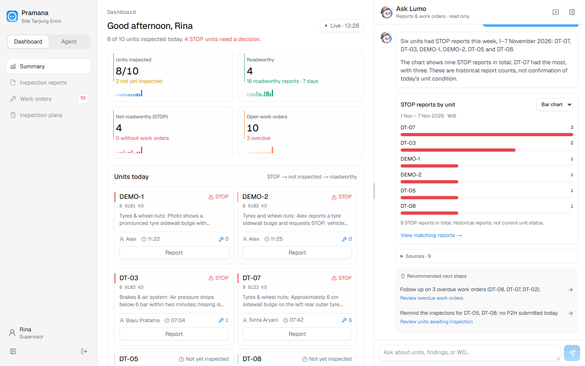
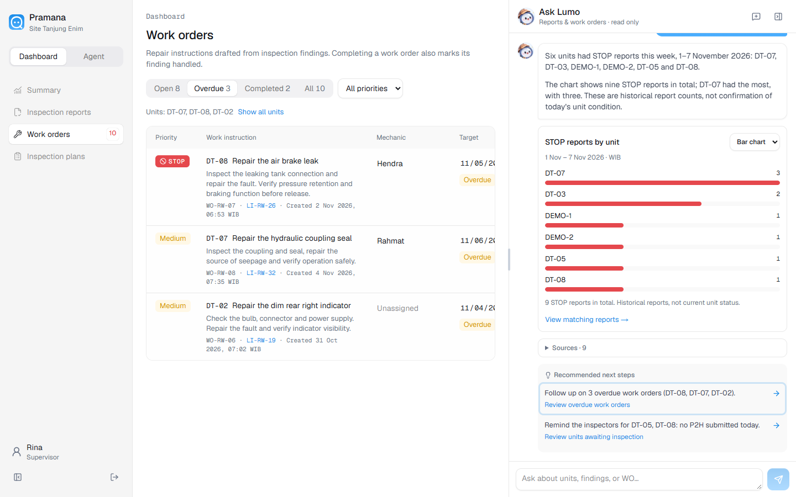
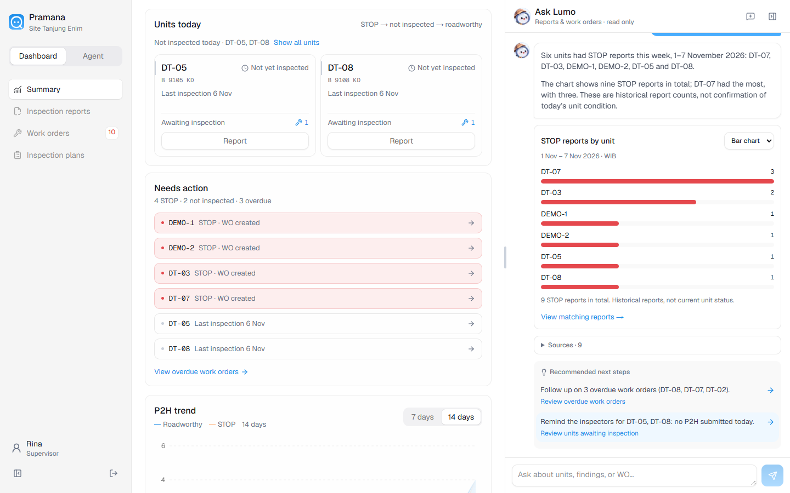
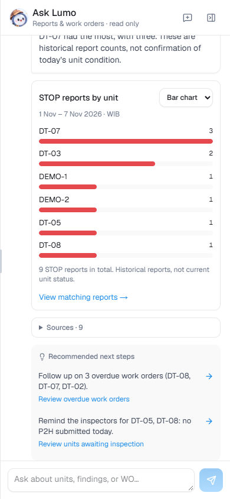
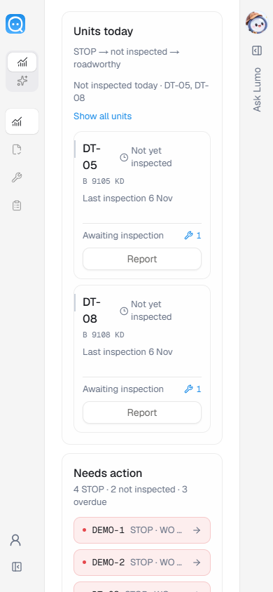

# Clickable Lumo recommendations

Verified on 7 November 2026 against the Docker app at `http://localhost:3002`.
Application copy remains in English.

## Behavior

- Recommendations in saved conversations and daily suggestions are actionable
  rows with a visible destination label and arrow.
- “Follow up on 3 overdue work orders (DT-08, DT-07, DT-02)” opens Work orders
  with Overdue selected and those three units selected. Unit filters survive
  reload; “Show all units” clears only the unit selection.
- “Remind the inspectors for DT-05, DT-08” opens Summary at Units today,
  showing only those units that have not been inspected today. The action label
  is “Review units awaiting inspection”; this opens the review view and does
  not send a notification. The app has no inspector messaging service.
- Report, work-order, unit and recurring-component recommendations use verified
  records and local application routes. The original recommendation strings
  remain unchanged, and existing conversations receive actions when read.
- Other advice offers “Discuss with Lumo”, which sends a follow-up question in
  the current conversation. The button is disabled while Lumo is responding.
- On small screens, opening a recommendation closes the overlay so the
  destination is visible. Desktop keeps the panel open. Modified clicks retain
  normal browser behavior.

## Verification

- `npm test`: 34 passed, including daily recommendation destinations, validated
  report/work-order references, mechanic-versus-inspector routing, old
  conversations, generic advice, and unchanged report/work-order records.
- `npm run typecheck`: passed.
- Docker production build and health check: passed, using the existing data
  volume and port 3002.
- Typography/color scans and `git diff --check`: passed; the existing manifest
  theme color is an allowed design-system exception.
- Headless Chrome at 1440×900 and 390×844: keyboard activation, correct overdue
  records, two awaiting-inspection units, reload persistence, clear filters,
  empty results, daily recommendations and mobile navigation passed.
- Navigation made no API mutations, and reports/work orders were identical
  before and after. No browser console errors or failed HTTP responses.
- Generic conversation follow-up was tested with browser route fixtures: one
  expected question, pending-state protection and answer rendering. No real
  model invocation was needed for this navigation change.

Run `pramana/scripts/recommendation-ui-check.mjs` with `PLAYWRIGHT_MODULE` set
to the Playwright entry point. `PRAMANA_URL` and `CONVERSATION_ID` can override
the defaults. The default saved conversation uses the two recommendations
above. Results are in [recommendation-ui-results.json](recommendation-ui-results.json).

